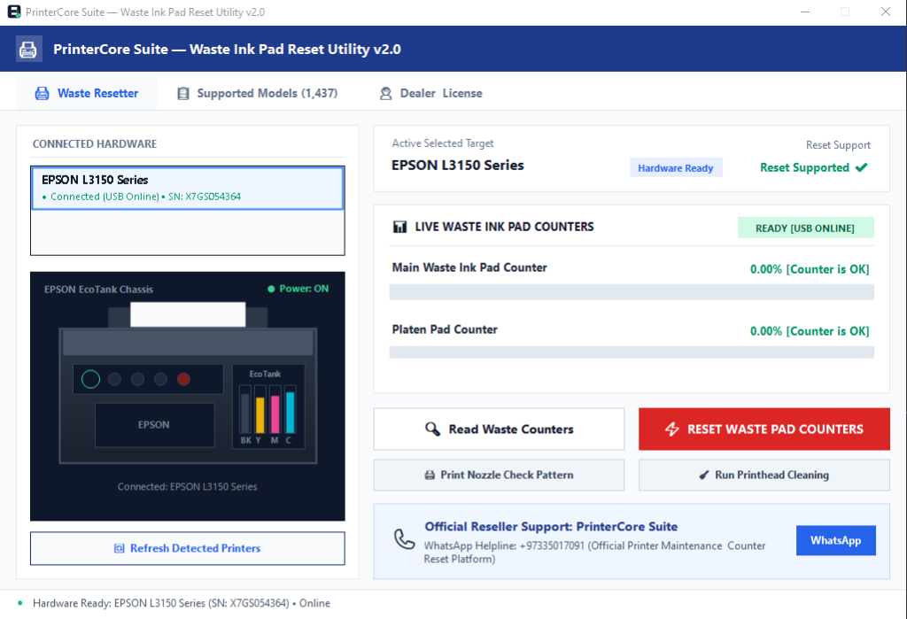
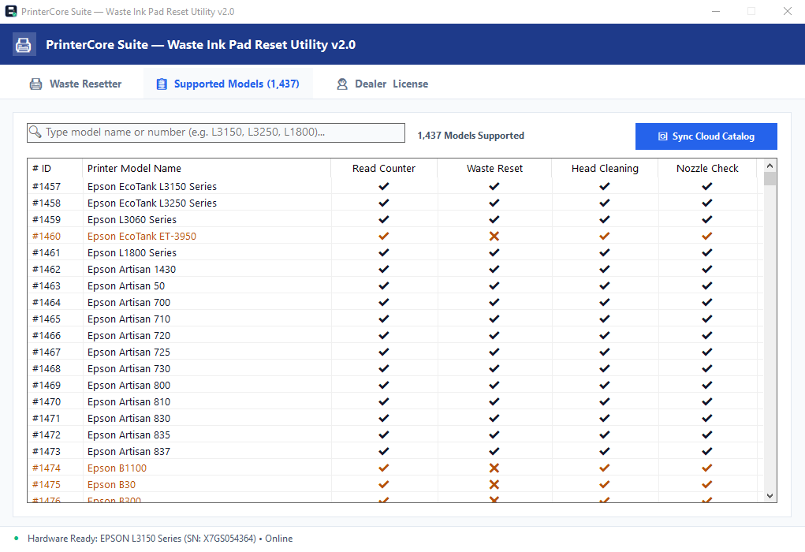
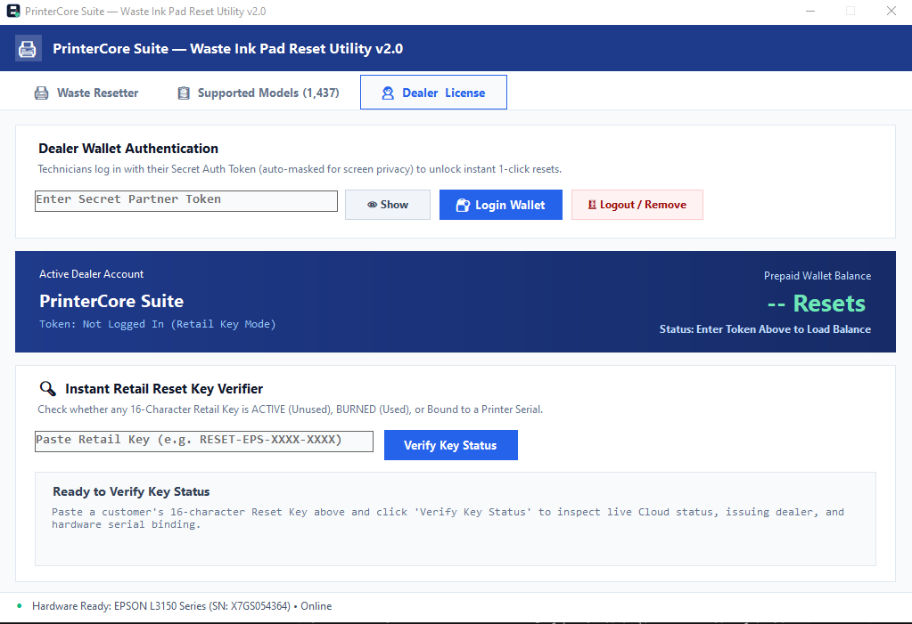

# 🖨️ Universal Epson Waste Ink Pad Resetter & Hardware Diagnostics (v2.0)
### Pioneered & Engineered by Md Tazmir (OxLogic) • A Historic Milestone for Bangladesh 🇧🇩

[-blue.svg)](#)

> **Language / ভাষা:** [English Overview](#english-overview) • [বাংলা বিবরণ](#-বাংলা-বিবরণ-বাংলাদেশি-ইঞ্জিনিয়ারিংয়ের-এক-নতুন-অধ্যায়)

---

## 📸 Software Interface Previews

### 1. Main Hardware Diagnostic & Waste Counter Resetter

### 2. Live Cloud Catalog (1,437+ Verified Hardware Profiles)

### 3. Authorized Dealer Portal & Retail Key Verification

---

## ⬇️ Download Verified Software
- **Official Standalone Utility (.EXE):** Download from the [Releases Tab](../../releases) (`InkClear_Universal_Resetter.exe`)
- **System Requirements:** Windows 10 / 11 (64-bit & 32-bit) • Direct USB Connection • No Installation Required

---

## 🌐 English Overview: Breaking the Foreign Monopoly

For decades, millions of printer technicians, studios, and businesses across South Asia and globally faced the same problem: **"Waste Ink Pad Counter Overflow"** (alternating red lights, error code `E-11`, `Service Required`).

Users were historically forced to rely on:
1. **Untrusted Foreign Cracks:** Shipped with trojans, spyware, and keyloggers from suspicious forums.
2. **Exorbitant Single-Use Licenses:** High pricing with zero customer support or safety guarantees.
3. **Motherboard Bricking Risks:** Primitive scripts crashing mid-reset, corrupting delicate printer boards.

### 🔬 The Breakthrough
After months of exhaustive **systems engineering, hardware diagnostics, and low-level software research**, I successfully engineered **InkClear / PrinterCore Suite** from Bangladesh 🇧🇩 under **OxLogic**.

It is the first native, clean-room universal hardware utility supporting **1,450+ Epson models** built entirely from Bangladesh.

---

## ⚡ Core Features

- **Real-Time Saturation Telemetry:** Reads live counter percentages (`0.00% - 100.00%`).
- **Atomic One-Click Zeroing:** Cleans internal overflow registers safely in seconds.
- **Free Built-in Diagnostic Utilities:** One-click Printhead Cleaning and Nozzle Check Pattern generation.
- **Hardware Pre-Flight Guard:** Verifies printer readiness before sending reset sequences to guarantee zero bricking risk.

---

## 🇧🇩 বাংলা বিবরণ: বাংলাদেশি ইঞ্জিনিয়ারিংয়ের এক নতুন অধ্যায়

বছরের পর বছর ধরে আমাদের দেশের কম্পিউটার দোকানদার, ফটোকপি ব্যবসায়ী এবং প্রিন্টার টেকনিশিয়ানরা একটি সাধারণ সমস্যায় জিম্মি হয়ে ছিলেন—এপসন প্রিন্টারের **"Waste Ink Pad Overflow"** বা লাল বাতি জ্বলে প্রিন্টার অচল হয়ে যাওয়া।

আজ পর্যন্ত এই সমস্যার সমাধানের জন্য পুরো বাংলাদেশ নির্ভর করত:
1. **বিদেশি ম্যালওয়্যারযুক্ত ক্র্যাক সফটওয়্যার:** যা রাশিয়ান বা চীনা সাইট থেকে নামাতে গিয়ে কম্পিউটারে ভাইরাস, ট্রোজান ও ফাইল লক হওয়ার মতো সর্বনাশ হতো।
2. **চড়া মূল্যের বিদেশি রিসেট কি:** সামান্য একটা রিসেটের জন্য চড়া দামে বিদেশি সফটওয়্যার কিনতে হতো, যার কোনো গ্যারান্টি বা সাপোর্ট থাকত না।
3. **মাদারবোর্ড নষ্ট হওয়ার ঝুঁকি:** ভুলভাল সফটওয়্যার ব্যবহার করে বহু প্রিন্টারের মাদারবোর্ড চিরতরে নষ্ট হয়ে যেত।

### 🔬 দীর্ঘ গবেষণার পর নিজস্ব প্রযুক্তি আবিষ্কার
বাইরের কোনো রেডিমেড বা ক্র্যাক করা কোডের ওপর নির্ভর না করে—**মাসের পর মাস গভীর সিস্টেম ইঞ্জিনিয়ারিং ও প্রিন্টার হার্ডওয়্যার অ্যানালাইসিসের মাধ্যমে** আমি বাংলাদেশ থেকে প্রথম সম্পূর্ণ নিজস্ব আর্কিটেকচারে এই ইউনিভার্সাল প্রিন্টার রিসেটার টুলটি তৈরি করেছি।

**OxLogic**-এর অধীনে এটিই বাংলাদেশের প্রথম দেশীয় সফটওয়্যার, যা একক ক্লিকে এপসনের **১,৪৫০টিরও বেশি মডেলকে ১০০% নিরাপদে রিসেট করতে সক্ষম**।

### 🛡️ এই সফটওয়্যারের মূল বৈশিষ্ট্য:
- **১০০% ক্লিন ও নিরাপদ:** কোনো থার্ড-পার্টি বিপজ্জনক ক্র্যাক নেই; সম্পূর্ণ দেশীয় ও সুরক্ষিত প্রযুক্তিতে তৈরি।
- **রিয়েল-টাইম হার্ডওয়্যার গার্ড:** রিসেট করার আগে সফটওয়্যারটি নিজে যাচাই করে প্রিন্টার সম্পূর্ণ নিরাপদ অবস্থায় আছে কি না—যার ফলে প্রিন্টারের ক্ষতি হওয়ার ০% ঝুঁকি।
- **লাইভ কাউন্টার রিডিং:** প্রিন্টারের ভেতরের মূল প্যাড এবং প্লেটেন প্যাড ঠিক কত শতাংশ (`0.00% - 100.00%`) পূর্ণ হয়েছে, তা এক ক্লিকে দেখা যায়।
- **ফ্রি মেইনটেন্যান্স টুলস:** হেড ক্লিনিং (Head Cleaning) এবং নোজল চেক (Nozzle Check) কোনো লাইসেন্স বা কি ছাড়াই সম্পূর্ণ বিনামূল্যে চালানো যায়।

---

## 💻 সমর্থিত মডেলসমূহ (১,৪৫০+ ভেরিফায়েড মডেল)

- **EcoTank L-Series:** L1110, L3110, L3150, L3156, L3160, L3210, L3250, L3251, L4150, L4160, L5190, L6190, L8050, L18050 সহ আরও ৪০০+ মডেল।
- **EcoTank M-Series (Monochrome):** M1100, M1120, M1140, M1170, M2140, M3170 ইত্যাদি।
- **Photo & Artisan Series:** L800, L805, L850, L1800, Artisan 50, Artisan 1430, Stylus Photo R230, R330 ইত্যাদি।
- **WorkForce Series:** WF-2830, WF-2850, WF-3720, WF-7710, WF-7720 ইত্যাদি।
- **Large Format & Pro:** SC-P600, SC-P800, Stylus Pro 3880, 4880, 7890, 9890 ইত্যাদি।

---

## 🚀 কীভাবে ব্যবহার করবেন

1. প্রিন্টারের সাথে কম্পিউটারের **ইউএসবি কেবল** সরাসরি সংযুক্ত করুন (ওয়াইফাই বা নেটওয়ার্ক মোড বন্ধ রাখুন)।
2. [Releases](../../releases) পেজ থেকে `InkClear_Universal_Resetter.exe` ফাইলটি নামিয়ে নিন।
3. ফাইলের উপর রাইট-ক্লিক করে **Run as Administrator** হিসেবে চালু করুন।
4. **Read Waste Counters** বাটনে ক্লিক করে বর্তমান কাউন্টারের অবস্থা দেখুন।
5. **Reset Waste Pad Counters** বাটনে ক্লিক করুন। সফটওয়্যার নির্দেশ দিলে প্রিন্টারটি একবার অফ করে আবার অন করুন—ব্যস, আপনার প্রিন্টার সম্পূর্ণ সচল ও প্রস্তুত!

---

## 👨‍💻 ক্রিয়েটর ও সোশ্যাল প্রোফাইল

- **প্রজেক্ট আর্কিটেক্ট ও লিড ডেভেলপার:** **মোঃ তাজযীর (Md Tazmir)** ([@mdtazmir1](https://github.com/mdtazmir1))
- **রিসার্চ ও টেক ল্যাব:** **OxLogic**
- **দেশ:** **বাংলাদেশ 🇧🇩**
- **LinkedIn প্রোফাইল:** [Md Tazmir on LinkedIn](https://www.linkedin.com/in/md-tazmir-a6b0a61a6/)
- **Facebook প্রোফাইল:** [Muhammad Tazmir on Facebook](https://www.facebook.com/muhammadtazmir)
- **সরাসরি সাপোর্ট ও সহযোগিতা:** [GitHub Issues](../../issues) অথবা [WhatsApp](https://wa.me/97335017091)

---

---

## 🔬 গবেষণা পরিধি, হার্ডওয়্যার নিরাপত্তা ও কমিউনিটি সহায়তা

### ১. মডেল কাভারেজ ও বাস্তব ফিল্ড টেস্টিং
এই সফটওয়্যারটি ১,৪৫০টিরও বেশি এপসন মডেলের স্বয়ংক্রিয় ডিজিটাল কাউন্টার রিসেট করার জন্য তৈরি। সাধারণ যুক্তিতেই একজন একক গবেষকের পক্ষে ১,৪৫০টি প্রিন্টার বাস্তবে কিনে এনে ফিজিক্যালি টেস্ট করা সম্ভব নয়।
- **ধারাবাহিক আপডেট:** আমরা প্রতিনিয়ত নতুন মডেলের ডেটা অ্যানালাইসিস করছি এবং নিয়মিত ক্লাউড ক্যাটালগ আপডেট পাঠাচ্ছি।
- **ভবিষ্যৎ রোডম্যাপ:** এপসন হলো আমাদের প্রথম ধাপ। ধাপে ধাপে আমরা **ক্যানন (Canon), এইচপি (HP), এবং ব্রাদার (Brother)** প্রিন্টারের জন্য ইউনিভার্সাল হার্ডওয়্যার রিসেট সাপোর্ট নিয়ে আসব।

### ২. হার্ডওয়্যার নিরাপত্তা নিশ্চয়তা (Non-Destructive Safety)
- **ক্ষতিকারক কোনো কোড নেই:** আমাদের সফটওয়্যারে এমন কোনো ক্ষতিকারক লজিক নেই যা আপনার প্রিন্টারের ক্ষতি করতে পারে। এটি কেবল নিরাপদে অতিরিক্ত কাউন্টার জিরো করে প্রিন্টারকে সচল করে।
- **প্রি-ফ্লাইট গার্ড:** রিসেট করার আগে সফটওয়্যারটি প্রিন্টারের স্বাভাবিক কানেকশন যাচাই করে নেয়, যাতে কোনো ত্রুটি না হয়।

### ৩. দায়বদ্ধতা ও বাস্তব ডিসক্লেইমার (Fair Responsibility)
যেহেতু প্রিন্টারের ফিজিক্যাল হার্ডওয়্যার পূর্বে থেকেই পুরোনো বা নষ্ট থাকতে পারে, শর্ট সার্কিট থাকতে পারে কিংবা নিম্নমানের ইউএসবি কেবল বা বিদ্যুৎ বিভ্রাটের কারণে সমস্যা হতে পারে—তাই সফটওয়্যারটি **"যথা-অবস্থায়" (AS-IS)** প্রদান করা হয়েছে। ফিজিক্যাল প্রিন্টার পরিচালনার সম্পূর্ণ দায়িত্ব ব্যবহারকারী বা টেকনিশিয়ানের নিজের।

### ৪. সরাসরি ফিডব্যাক ও দ্রুত আপডেট (সবার সহযোগিতা একান্ত কাম্য)
**বাংলাদেশ থেকে প্রথম ব্যক্তি হিসেবে** এত বড় ও জটিল হার্ডওয়্যার রিভার্স-ইঞ্জিনিয়ারিংয়ের কাজ শুরু করেছি। তাই এই দেশীয় প্রযুক্তিকে বিশ্বমানের করে তুলতে প্রতিটি টেকনিশিয়ান ও ইউজারের গঠনমূলক সহায়তা একান্ত প্রয়োজন।
- আপনার কোনো প্রিন্টারের মডেল যদি বিশেষ কোনো কারণে রিসেট না হয় বা কোনো এরর দেখায়—**ঘাবড়ানোর কিছু নেই! সরাসরি আমাদের WhatsApp হেল্পলাইনে বা GitHub Issue-তে যোগাযোগ করুন।**
- আপনার প্রিন্টারের মডেল জানালে আমরা দ্রুত সেটির জন্য সফটওয়্যারের ক্লাউড আপডেট দিয়ে দেব।

## ⚠️ লিগ্যাল ডিসক্লেইমার
*Epson এবং সংশ্লিষ্ট সমস্ত মডেলের নাম Seiko Epson Corporation-এর নিবন্ধিত ট্রেডমার্ক। এই সফটওয়্যারটি একটি সম্পূর্ণ স্বাধীন থার্ড-পার্টি ডায়াগনস্টিক ও টেকনিক্যাল গবেষণাভিত্তিক টুল, যা প্রিন্টারের দীর্ঘস্থায়ী কার্যক্ষমতা এবং রাইট-টু-রিপেয়ার (Right to Repair) নিশ্চিত করার লক্ষ্যে তৈরি করা হয়েছে।*
